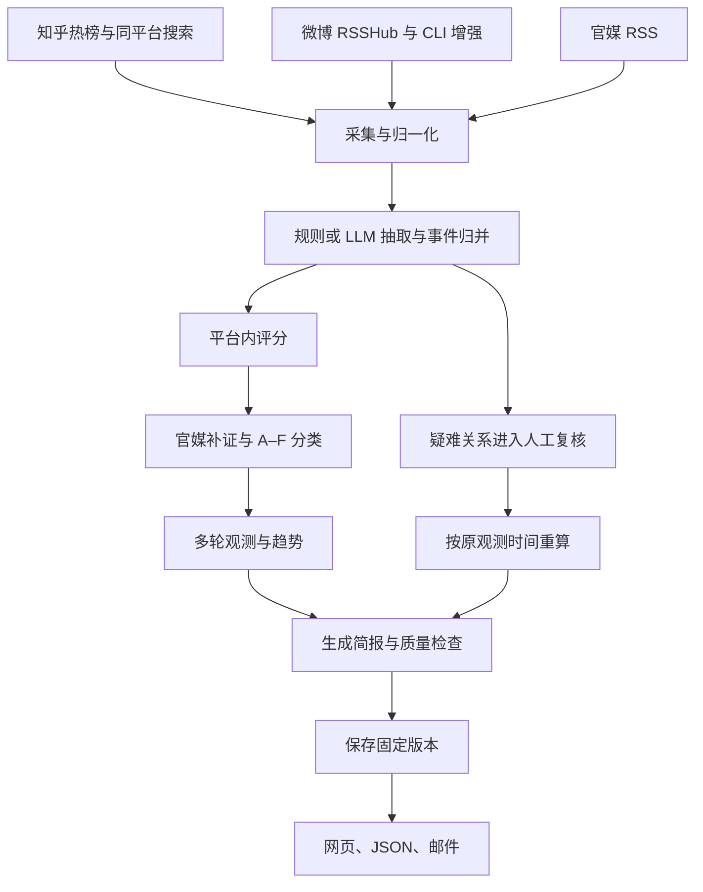

# 舆情热点分析系统

从知乎热榜、微博 RSSHub 热搜和官媒 RSS 中发现事件，判断不同来源是否在讨论同一件事，默认生成过去 **24 小时的每日简报**，也支持本次采集运行或自定义时间窗口。简报同时展示各平台关注的事件、A–F 来源分类，以及知乎／微博各自的热度变化，可在网页查看，或通过 HTML／纯文本邮件推送。

[近期更新](#近期更新2026-10-29) · [项目逻辑](#项目逻辑) · [工作流程](#工作流程) · [设计思路](#设计思路) · [技术栈](#技术栈) · [运行入口](#运行入口) · [邮件推送](#邮件推送) · [文档导航](#文档导航) · [验证记录](#验证记录)

当前已实现分析链路、管理后台、邮箱管理和 Docker 定时日报。本地容器与测试邮箱已验证；阿里云连续一天运行、真实收件箱验收仍待完成。长图导出和指定事件检索（Mode B）尚未实现。DeepSeek 独立判断后端已接入，默认关闭，已完成有限历史样本的真实 API 回放，尚未完成全量与持续运行验收。

## 近期更新（2026-10-29）

- **规则／LLM 独立切换（10月29日）**：新增 `EVENT_REASONING_MODE=rules|llm`，统一控制事件抽取、搜索相关性、同平台／跨平台归并及官媒补证。LLM 输出带原文引用并经 Schema 校验，不叠加旧模型分数，失败不自动回退规则。默认保留原后端；已做模拟响应测试和有限历史样本真实回放，仍有相关性误判及时间格式失败，配置、预算和验证边界见[DeepSeek 接入说明](docs/llm-reasoning.md)。同时修复微博返回的长正文未被解析的问题，历史数据不自动重写。

- **微博热门采样（10月25日）**：CLI 搜索由 `time` 改为 `hot`，优先取得平台筛选的热门微博；保留默认每话题10条、相关性过滤及现有热度条数指标。新旧排序通过采样签名区分，不混算趋势，见[数据源与采样边界](docs/data-sources.md)。
- **批量归并与互斥提示**：人工复核支持勾选多项，各自归入展示目标；同一线索指向不同事件时显示互斥关系并禁用冲突选择。后端整批预检归属、保留逐条审核记录，成功项统一重算热度与简报，见[使用方法、约束和恢复说明](docs/batch-review-and-exclusivity.md)。
- **话题正文与来源摘要**：微博复用已接纳的 CLI 正文补强匹配两侧和来源摘要，知乎展示问题描述；增加跨平台共同关注栏目，允许短热榜话题独立保留，并在父话题审核后回挂同问题回答，见[方案、边界与修改记录](docs/topic-content-and-parent-resolution.md)。
- **Embedding 联合判断**：知乎、微博、官媒之间的语义归并及官媒补证增加0.60／0.70分段门槛，阻止低 embedding 被高 reranker 放行，见[规则、边界与验证](docs/embedding-merge-gate.md)。高分正文路径继续保留冲突与竞争候选检查；知乎简报同时展示榜位与平台内热度分。
- **CLI 正文出处修复与离线复核**：兼容只有微博 ID、没有 URL 的已接纳样本，恢复匹配上下文和摘要引用；已刷新本地历史简报。高分误判与平台放行范围仍有待优化，详见[正文恢复后的归并复核](reports/cli-context-rematch-audit-2026-10-23.md)和[reranker 输入诊断](reports/reranker-input-diagnosis-2026-10-23.md)。
- **官媒全文与摘录摘要**：官媒 RSS 和定向搜索共用原文提取、缓存及原句摘要；精简内容用于事件匹配、官媒补证和简报展示，失败回退来源描述，不新增 LLM 费用。见[实现、配置和限制](docs/official-article-content.md)。

- **任务状态与用量展示（10月21日）**：主页自动刷新执行阶段、各来源采集结果及微博增强进度，运行区域展示本轮接口用量，见[任务进度说明](docs/run-progress.md)。

- **知乎互动热度与独立采集**：已接纳的同轮回答互动进入对应问题的主热度；后台可选择备份旧数据库后清空业务数据，独立采集并生成本次简报，见[使用说明与修改记录](docs/fresh-collection-and-zhihu-heat.md)。
- **可配置连续采集**：后台可选择运行时长、采集间隔和结束动作，保留8小时／每小时一次的快捷方案；结束后可只保存数据或生成本地简报，不自动发送邮件。
- **按窗口生成简报**：支持本次运行、过去24小时和自定义窗口，按窗口内实际采到并接纳的证据分类，避免历史事件混入。连续采集入口覆盖知乎、微博和官媒 RSS（中新网、人民网、新华网），官媒补证搜索遵循配置，支持独立的7天回溯窗口及“此前报道”标注，见[官媒补证说明](docs/official-evidence.md)。
- **审核后保留热度趋势**：重新生成时沿用原始观测、采样间隔和时间窗口；跨平台关联保留，但只有窗口内的来源证据参与当期分类。
- **优化审核归并**：有标题依据、无明确冲突的高语义分数候选可自动归并；10月20日改用稳定来源身份去重审核关系，保留轮次信号及证据历史，详见[跨轮审核去重方案与修改记录](docs/review-relation-identity.md)。
- **修正审核与展示**：独立建事件支持填写名称，默认使用原话题标题；排除缺少当前引用的事件时给出提示，正文引用缺失、空简报等仍阻止发布。

具体规则、使用方法和验证限制见[采集窗口、简报与事件归并](docs/collection-windows-and-merging.md)。本次修复经过374项离线回归，标题修复另通过10项人工审核测试；本地夜间数据重建得到85个事件（知乎41、微博44），未进行邮件投递。

## 项目逻辑

项目以**事件**作为连接各来源的单位：热榜话题负责发现，搜索样本负责补充，事件归并决定哪些证据可以放在一起。单平台事件可以独立保留；跨平台合并必须有足够依据。

| 要回答的问题 | 系统如何处理 |
| --- | --- |
| 过去 24 小时各平台关注什么？ | 分别生成知乎、微博和官媒栏目，同一事件可以出现在多个栏目中 |
| 哪些事件受到共同关注？ | 对已归并事件的来源证据做 A–F 分类，保留匹配理由和引用 |
| 事件在平台内变热还是变冷？ | 知乎优先比较真实榜位；微博比较同采样口径的 CLI 增强指标与平台分 |
| 结果为什么可信或需要保留意见？ | 展示来源状态、证据、缺失字段、分类置信度和待人工复核项 |

**A–F 表示来源覆盖和官媒支撑，不是跨平台热度分数。** 知乎与微博分别计算热度，官媒只提供报道证据和覆盖信息。搜索命中不等于上榜，RSS 列表位置也不等于微博官方热度。

自动流程各自使用知乎／微博热榜发现话题，再做同平台搜索增强；不从一个平台的热榜自动触发另一个平台搜索。微博 CLI 开启后默认覆盖本轮全部入选 RSS 话题，逐条过滤搜索结果后汇总指标。未通过归并的增强结果不能独立创建热点。

进一步阅读：[产品与展示设计](docs/product-design.md) · [分类规则](docs/hotspot-classification.md) · [热度、趋势与离榜判断](docs/platform-heat.md)。

## 工作流程



分析使用固定九步 `Plan → AgentTaskRunner → ToolRegistry` 编排，随后执行生成、检查、保存三步日报流程。每一步都有结构化输入输出和执行记录。手动发布需要确认版本；开启自动日报后，系统按配置生成并确认质量检查通过的每日版本。

详细执行顺序、数据交接、失败降级和回放方法见 [工作流与架构](docs/architecture.md)。

## 设计思路

- **先保留来源，再建立事件关系。** 以稳定 `event_id` 串起条目、证据、评分和趋势；记录父话题与搜索结果的关系，方便追溯和纠错。
- **模型辅助匹配，规则决定边界。** 身份、URL、BM25、embedding 和 reranker 提供候选与特征；实体、动作、时间约束和 Guardrails 决定合并或转人工，高模型分不能覆盖明确冲突。
- **缺失与失败显式表达。** 成功取得的有效短榜／空榜可用于确认离榜；采集失败或榜单残缺保留未知。离榜不立即删除过去 24 小时的关注记录。
- **观测与展示版本分开。** 重算不会制造新采集时间，已保存的日报内容不会随之后的采集改变。审核修正产生新草稿，邮件按版本和收件人去重。
- **保留可审计的自动化。** 当前 Agent 仍是固定工具工作流；语义判断可在原后端与 DeepSeek 之间独立切换，默认原后端。日报摘录与质量检查仍使用模板和规则，不由 LLM 自主选择工具。

## 技术栈

| 层次 | 当前使用的技术 |
| --- | --- |
| 后端与接口 | Python 3.11+、FastAPI、Uvicorn、Pydantic／pydantic-settings |
| 持久化与调度 | SQLAlchemy 2、SQLite；数据库任务队列、租约与单进程协调器 |
| 采集 | HTTPX、RSS XML 解析、RSSHub、`@weibo-ai/weibo-cli` |
| 事件匹配 | 身份／URL、BM25、字符 N-gram、RRF、本地 BGE embedding 与 ONNX reranker |
| 前端与邮件 | 原生 HTML／CSS／JavaScript；HTML＋纯文本 multipart 邮件、SMTP |
| 部署与验证 | Docker Compose、CPU 模型只读挂载、按天 JSONL 日志；pytest、Ruff、Playwright、Mailpit |

依赖见 [pyproject.toml](backend/pyproject.toml) 和 [Linux 依赖锁定](backend/requirements-linux.lock)；模型与匹配模式见 [事件匹配](docs/event-matching.md#模型安装与运行)。当前没有依赖向量数据库、Redis 或 Celery。

## 运行入口

| 场景 | 从这里开始 |
| --- | --- |
| 使用 Docker 运行完整系统、配置定时日报和一天试运行 | [部署指南](docs/deployment.md)；使用根目录 `compose.yml` |
| 本地 Python 开发、登录后台、采集、审核、管理邮箱与导出 | [后台使用指南](docs/user-guide.md) |
| 可配置采集、统计窗口、审核后重算与自动归并 | [采集窗口与归并说明](docs/collection-windows-and-merging.md) |
| 只跑一轮分析或离线回放 | [工作流：运行与离线验证](docs/architecture.md#运行与离线验证) |
| 配置知乎、微博与官媒来源 | [数据源与采集](docs/data-sources.md) |
| 运行回归测试和业务评估 | [评估指南](docs/evaluation.md) |

完整后端与管理页面由 `app.main:app` 提供，`app.briefing_cli` 管理日报任务，`app.analysis_cli` 执行单轮分析。`docker-compose.weibo.yml` 仅用于微博采集调试。配置模板是 [backend/.env.example](backend/.env.example) 和 [deploy/.env.example](deploy/.env.example)，实际密钥保留在本地配置中。

先验证项目的离线链路，可在已安装 Python 3.11+ 的 Windows 环境从仓库根目录执行：

```powershell
py -3.11 -m venv .venv
.\.venv\Scripts\python.exe -m pip install -e "./backend[dev]"
cd backend
..\.venv\Scripts\python.exe -m pytest tests/test_evaluation_runner.py -q
```

这组测试使用固定数据与规则配置，不调用真实来源。完整采集需要配置来源凭据；默认语义匹配还需按[模型安装指南](docs/event-matching.md#模型安装与运行)准备本地权重。

## 邮件推送

日报支持通过 SMTP 发送 HTML／纯文本邮件。管理员分别在“邮件设置”和“收件人管理”中配置发件服务、调度与接收名单；可以先手动确认并发送，再开启每天定时采集、生成与投递。系统保存逐地址回执，按版本与收件人去重，对发送结果未知的邮件保留人工核实入口。

邮件设置保存到数据库后无需重启，授权码加密存储；部署环境保留初始配置及独立加密密钥。页面支持检查连接和主动发送测试邮件。

接入步骤、环境配置和排查方法见[邮箱配置与日报投递](docs/email-delivery.md)。真实收件须单独验收，本地 Mailpit 仅用于隔离测试。

## 文档导航

本 README 是项目的统一阅读入口。先看产品与架构，再按需要进入设计、操作或验证文档；详细规则只在对应正文维护。

| 章节 | 内容与入口 |
| --- | --- |
| 产品与架构 | [产品设计](docs/product-design.md)：输出和边界；[系统架构](docs/architecture.md)：任务编排、数据交接、失败与回放 |
| 采集与证据 | [数据源](docs/data-sources.md)、[字段映射](docs/source-fields.md)、[搜索增强](docs/search-enrichment.md)、[官媒证据](docs/official-evidence.md) |
| 事件与热度 | [信号抽取](docs/event-extraction.md)、[事件匹配](docs/event-matching.md)、[DeepSeek 独立模式](docs/llm-reasoning.md)、[A–F 分类](docs/hotspot-classification.md)、[平台热度与趋势](docs/platform-heat.md) |
| 使用与部署 | [后台操作](docs/user-guide.md)、[邮箱配置与日报投递](docs/email-delivery.md)、[Docker 部署](docs/deployment.md)、[数据生命周期](docs/data-lifecycle.md) |
| 开发与验证 | [工具参考](docs/tool-reference.md)、[数据契约](docs/data-contracts.md)、[Guardrails](docs/guardrails.md)、[评估方法与复现](docs/evaluation.md) |
| 维护与演进 | [文档命名与维护](docs/documentation.md)、[更新日志](CHANGELOG.md)、[历史验证记录](#验证记录) |

代码入口按职责组织：

```text
backend/app/
├── agents/       # Plan、Runner 与分析流程
├── collectors/   # 来源采集
├── services/     # 归并、评分、日报、调度与邮件
├── schemas/      # Pydantic 输入输出契约
├── models/       # SQLAlchemy 持久化模型
├── evaluation/   # 固定用例、评估执行与报告
└── web/          # 管理后台
backend/tests/    # 回归测试
deploy/          # 部署模板与容器入口
docs/            # 当前设计、操作与开发说明
reports/         # 有版本或日期的验证证据
```

## 验证记录

以下数字来自注明日期的验收，保留当时输入、结果与限制。回归测试通过、业务标签符合预期、外部来源长期可用是不同结论。

| 验证 | 已记录的结果 | 详细报告 |
| --- | --- | --- |
| 每日简报，2026-10-07 | 291 项测试通过；固定版本、人工复核、页面及 SMTP 协议验证 | [简报验收](reports/briefing-acceptance-v0.1.md) |
| 本地 Docker，2026-10-08～09 | 容器采集、定时任务、日志、Mailpit 与重启去重验证；CLI 全话题覆盖回归 | [Docker 验收](reports/docker-acceptance-v0.1.md) |
| 邮箱管理，2026-10-10 | 323 项测试通过；浏览器操作、指定发送、名单持久化与去重验证 | [邮箱管理验收](reports/email-management-acceptance-v0.1.md) |
| 阿里云部署，2026-10-14～15 | 部署与 CLI 验证通过；低内存导致试运行中断，未通过连续 24 小时验收 | [服务器准备](reports/server-environment-2026-10-14.md)、[一天试运行](reports/server-trial-2026-10-15.md) |
| 本机资源测试，2026-10-16 | 两轮采集、38 次微博搜索成功，本地日报已生成；审核详情表格化，草稿按轮次折叠历史 | [资源与质量记录](reports/local-resource-profile-2026-10-16.md) |
| 离线匹配，2026-09-29～30 | 134 条基线与 208 条扩充集；完整匹配配置 193/208，保留失败案例 | [基线与修复跟踪](reports/evaluation-v0.1.md)、[模型对照](reports/evaluation-v0.2.md) |

离线扩充集参与过诊断，标签仍待人工复核，193/208 不代表生产准确率。真实 SMTP 收件与阿里云连续 24 小时运行仍待验收。

### 来源采样

| 主题 | 历史证据 |
| --- | --- |
| 来源选择 | [公开入口探测与访问判断](reports/source-probe-v0.1.md)、[微博／知乎接入路径](reports/weibo-zhihu-official-access-v0.1.md) |
| 知乎 | [热榜与同平台搜索采样](reports/zhihu-hotlist-search-sampling-v0.1.md) |
| 微博 | [RSSHub 话题采样](reports/weibo-rsshub-sampling-v0.1.md)、[CLI 搜索样本](reports/weibo-cli-search-statuses-limited-live-v0.1.md) |
| 官媒 | [RSS 字段](reports/official-news-structure-probe-v0.1.md)、[查询与议程能力](reports/official-media-capability-v0.1.md)、[定向查询实测](reports/official-search-validation-2026-09-29.md) |
| 早期分类实验 | [跨源分类样例](reports/cross-source-classification-probe-v0.1.md)、[初始标签](reports/evaluation-labels-v0.1.md)、[微博话题到知乎的搜索实验](reports/weibo-to-zhihu-search-sampling-v0.1.md)；当前自动流程不采用跨平台触发搜索 |
| 工程联调 | [采集器验收基线](reports/crawl-validation-v0.1.md)、[2026-09-26 集成检查](reports/integration-readiness-2026-09-26.md)、[2026-09-28 真实九步联调](reports/live-analysis-validation-2026-09-28.md) |

历史结果的 JSON、标签边界及复现命令见[评估指南](docs/evaluation.md)。报告保留当时的失败与限制；现行行为以本文所链接的设计和操作文档为准。

采用 [MIT License](LICENSE)。
