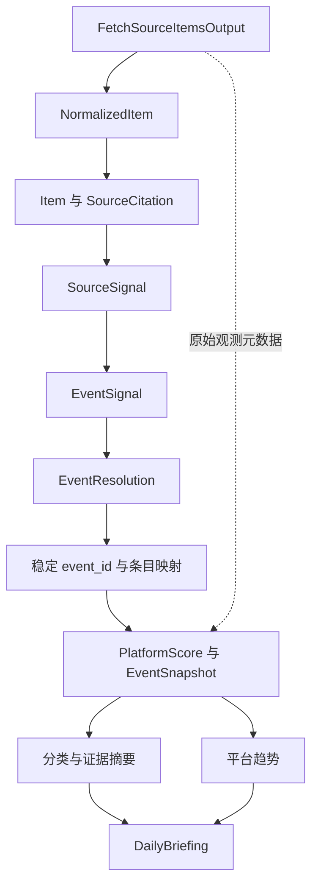

# 工作流与架构

[返回项目首页](../README.md) · [产品设计](product-design.md) · [工具参考](tool-reference.md)

系统由固定 Plan、任务状态机和结构化工具驱动。本文说明运行入口、数据交接与失败处理；LLM 动态规划未接入。

## 运行入口与职责

| 入口 | 职责 |
| --- | --- |
| [`app.main`](../backend/app/main.py) | FastAPI、静态管理页面、鉴权、启动任务协调器 |
| [`app.briefing_cli`](../backend/app/briefing_cli.py) | 初始化、日报采集任务、观察、状态和导出 |
| [`app.analysis_cli`](../backend/app/analysis_cli.py) | 执行一轮分析或回放采集响应，不启动周期调度 |
| [`JobCoordinator`](../backend/app/services/briefing_jobs.py) | 单实例数据库队列、租约、工作子进程与超时处理 |
| [`HotspotAnalysisAgent`](../backend/app/agents/analysis.py) | 构造并执行固定九步分析 Plan |
| [`Planner`](../backend/app/agents/planning.py) | 日报三步 Plan，以及独立采集、验证与检索占位 Plan |

API 和 CLI 复用业务服务。Collector 负责外部协议，Normalizer 负责结构清洗，事件服务负责身份与证据关系；Tool Registry 对输入输出做 Pydantic 校验并记录调用，Runner 按依赖推进任务。

## 固定九步分析

| 步骤 | Tool | 输入与结果 |
| --- | --- | --- |
| 1 | `fetch_source_items` | 调度知乎、微博和官媒 Collector；返回条目、每源状态、观测 ID、榜单完整性与采样口径 |
| 2 | `normalize_raw_items` | 清洗标题、URL、时间与指标结构，输出 `NormalizedItem`，保留原始指标语义 |
| 3 | `prepare_source_signals` | 保存／复用 `Source` 与 `Item`，建立来源引用和父话题关系，输出 `SourceSignal` 与匹配引用 |
| 4 | `extract_event_signals` | 规则抽取关键词、实体、动作、事件类型、时间提示和弱信号，输出 `EventSignal` |
| 5 | `match_and_resolve_events` | 召回和比较候选，经约束与 Guardrails 创建、归并、待复核或拒绝，保存稳定事件和条目关联 |
| 6 | `create_human_review_task` | 待确认关系进入人工队列；没有候选则跳过 |
| 7 | `calculate_event_scores` | 按本轮真实观测计算并保存知乎／微博各自的平台分和快照 |
| 8 | `classify_events` | 读取同窗口来源、官媒证据池与限额内定向查询，组装 A–F 分类和解释 |
| 9 | `analyze_event_heat` | 读取已保存观测，计算各平台连续上榜时间和趋势，不重复制造观测 |

`PlanStep.input_bindings` 显式引用前序输出，引用对象必须声明在 `depends_on` 中。绑定后实际调用的输入保存在任务日志。上述算法内部使用多个 service，并不意味着每个函数都注册为独立 Tool。

## 三个模块的数据交接



采集器先将不同响应映射成项目条目，Normalizer 再清洗成统一结构。`prepare_source_signals` 的关键工作是落库、复用身份、补齐 `source_citation.item_id`，不是再次采集或换算跨平台指标。

事件构建向分析阶段交接 `event_ids`、`event_ids_by_content_hash` 和原始采集输出。窗口内已跟踪事件也参加本轮观测处理，才能确认离榜或来源不可用。主要适配代码是 [`analysis_interfaces.py`](../backend/app/services/analysis_interfaces.py)。

## 身份与时间约定

| 标识 | 用途 |
| --- | --- |
| `run_id` | 一轮采集分析的身份；显式重跑会复用首次采集响应，新采集需要新 ID |
| `observation_id`、`observed_at` | 真实来源观测与观测时间；重评分不改变它们 |
| `Item.id` | 数据库条目主键，来源引用据此回溯 |
| `event_signal_id` | 某轮某来源的抽取结果，仅用于追踪该信号 |
| `event_fingerprint` | 匹配辅助特征，不代替事件身份 |
| `Event.event_id` | 稳定业务事件 ID，供分类、趋势、日报和复核共享 |

`window_end` 未指定时采用本轮最后一次来源观测；显式指定时必须带时区且不早于本轮观测。分类、趋势和日报共用 UTC `(window_end - 24h, window_end]`。同 `run_id` 回放不能修改采集参数或窗口。

社区热榜使用观测时间；官媒热点使用可靠发布时间。官媒旧报道、未来时间和缺失发布时间保留审计，不进入当天发现池。有效证据全都过期后，事件退出本轮输出，历史记录继续保存。不能把数据库中所有 `active` 事件直接当作当前榜单。

`calculate_event_scores` 在主链路中负责保存观测；随后 `analyze_event_heat` 只读取。独立调用趋势工具时可以传 `collection` 写入观测，但不能把重算旧 Item 当作新采样。

## 发现、增强与归并

自动分析以 `discovery_mode=automatic` 运行，先处理热榜种子，再处理搜索增强。知乎回答只有找到本轮同平台热榜父话题，并通过事件约束，才能挂到对应事件；未确认关系保持未关联并转复核，不独立建立热点。

微博 CLI 样本嵌在 RSSHub 父条目中，逐条相关性过滤后才汇总互动。自动流程不跨社区平台发起搜索。更细规则见[搜索增强边界](search-enrichment.md)。

官媒有独立报道发现和社区补证两条路径：前者可形成官媒独立事件，后者只为既有社区事件寻找候选依据。命中仍需核对实体、动作、时间和来源，不增加社区热度，见[官媒证据](official-evidence.md)。

## 日报、调度与邮件

九步分析输出 `HotspotAnalysisOutput`，它不是最终日报。日报 Plan 依次执行：

```text
generate_daily_briefing(run_id)
→ review_briefing_quality(briefing)
→ save_daily_report(briefing)
→ 固定版本的网页 / JSON / HTML与文本邮件
```

`DailyBriefing` 读取同轮同窗口的分类、趋势、引用和来源健康，生成三平台栏目及 A–F／unknown 栏目。当前内容生成和质量检查由确定性规则与模板完成，没有调用生成式 LLM。

| 开关 | 作用 |
| --- | --- |
| `SCHEDULER_ENABLED` | 周期采样，默认间隔 180 分钟 |
| `DAILY_BRIEFING_ENABLED` | 每日设定时间创建专用采集轮次，生成并自动确认质量通过的日报 |
| `EMAIL_SCHEDULE_ENABLED` | 定时投递；未开启自动日报时，发送当日人工确认版本 |
| `SCHEDULER_UNTIL` | 到期停止创建自动任务；已有任务收尾，后台仍可访问 |

基础配置默认关闭自动任务，Docker 部署模板可开启。每个“版本＋收件人”独立去重，定时投递冻结当日目标名单。发送时间、日志和试运行步骤见[部署指南](deployment.md)；邮箱管理见[MVP 使用指南](user-guide.md)。

## 失败、复核与幂等

- Tool 调用成功表示合法输入输出被执行；业务 `failed/partial/skipped` 要看输出与 Runner 任务状态。占位 `not_implemented` 会阻断对应任务。
- 来源失败但仍有结构化响应时，记录失败观测并保留其他来源成果；接口校验失败或工具异常会阻断依赖步骤。
- 成功取得的有效短榜／空榜可判断离榜，失败、已知残缺或范围不可比保留未知。趋势还需要连续且口径一致的观测。
- 待复核条目不提前关联候选事件。人工确认后按原始观测时间重算，生成新草稿；重算失败可重试，已保存版本内容不变。
- 同轮重跑复用采集响应和稳定身份，日报保存与邮件投递分别处理幂等。一次失败不会把旧分数伪装成当前观测。

## 运行与离线验证

完成[MVP 本地安装](user-guide.md#本地启动)后，在 `backend` 目录运行单轮分析：

```powershell
..\.venv\Scripts\python.exe -m app.analysis_cli --sources zhihu_hot_list --limit 5 --interval-minutes 120 --matching-profile rules --no-official-search
```

此命令真实调用知乎 API；`--interval-minutes` 仅声明预期采样间隔，不启动定时任务。默认匹配模式和模型安装见[事件匹配](event-matching.md#模型安装与运行)。

已有完整 `FetchSourceItemsOutput` JSON 时，在独立数据库回放：

```powershell
..\.venv\Scripts\python.exe -m app.analysis_cli --replay sample-round.json --database sqlite:///./data/replay.db --interval-minutes 120 --matching-profile rules
```

回放默认关闭官媒联网；需要补查时必须显式加 `--official-search`。回放文件应保留真实观测元数据，不把不完整历史样本声明成完整榜单。

接口回归与业务评估见[评估指南](evaluation.md)。真实采样和后续修复的日期证据见[验证记录](../README.md#验证记录)，不在工作流正文重复维护历史通过数。
